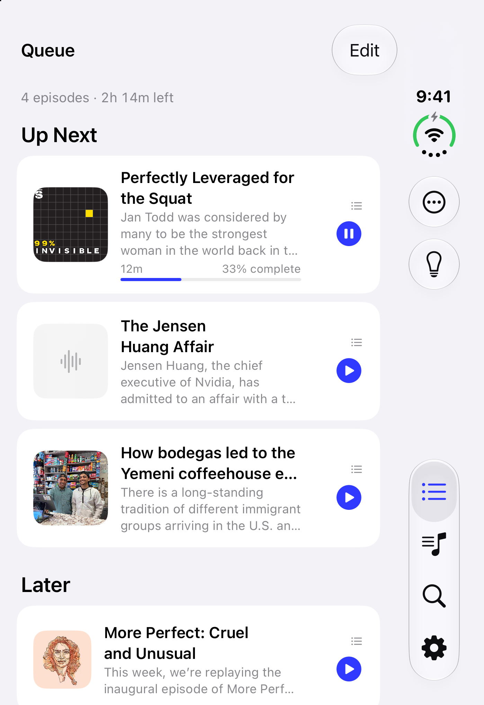
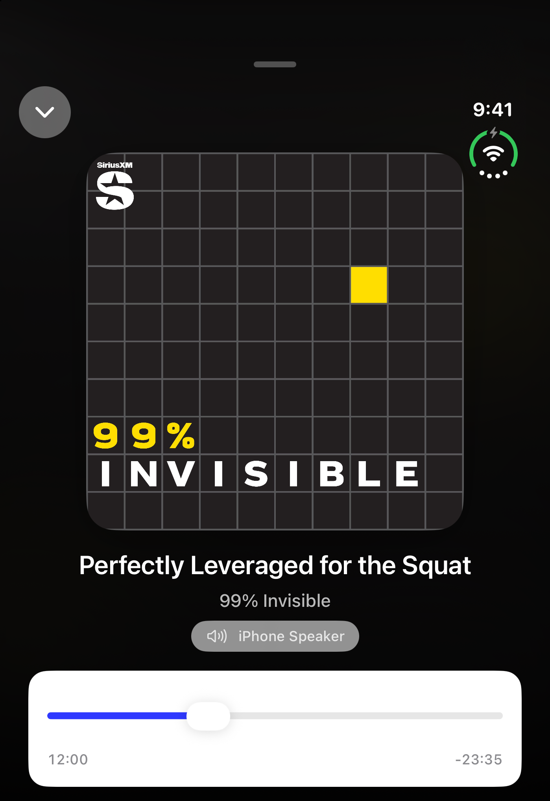
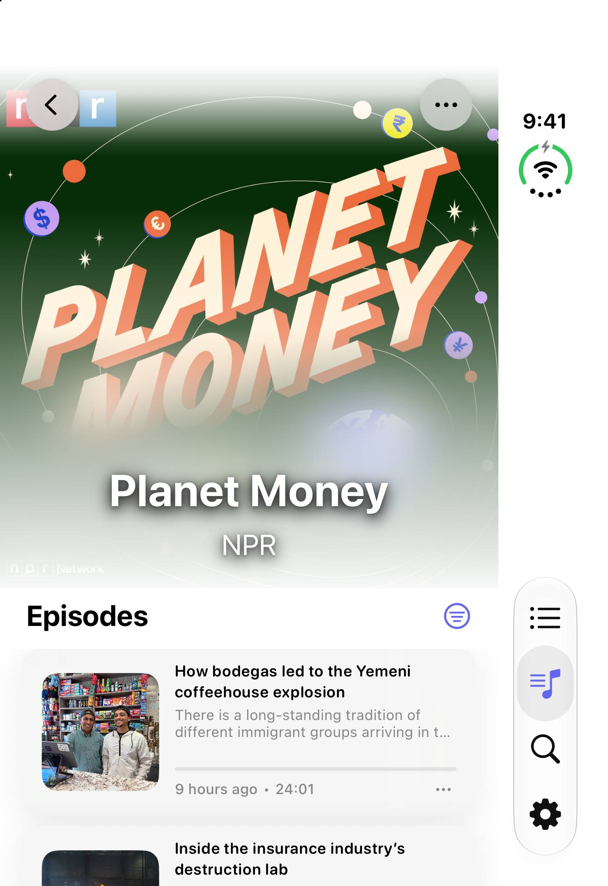
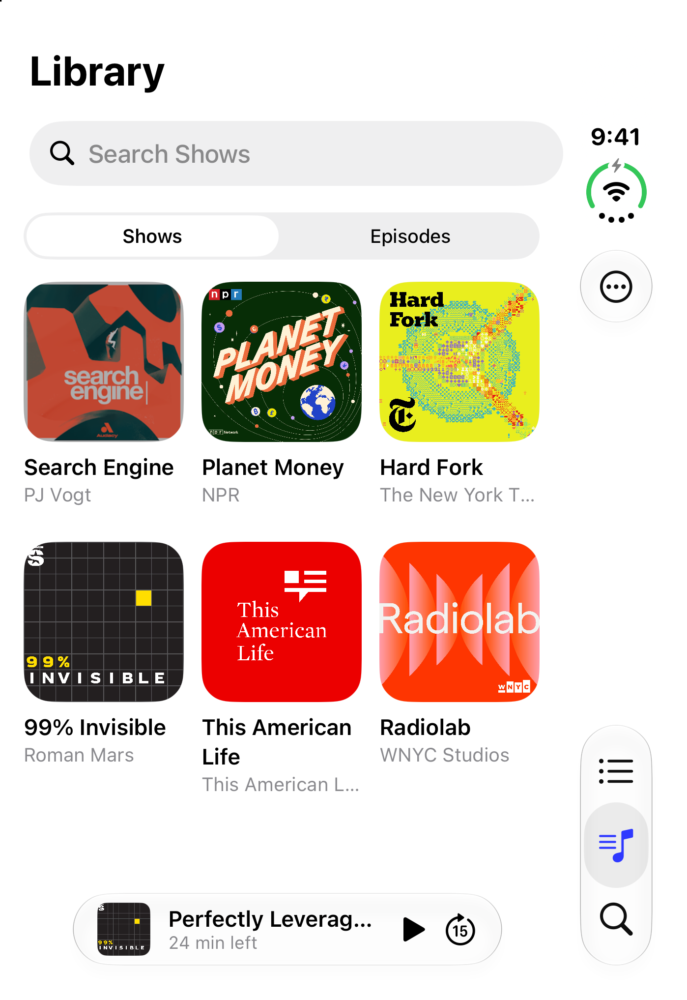
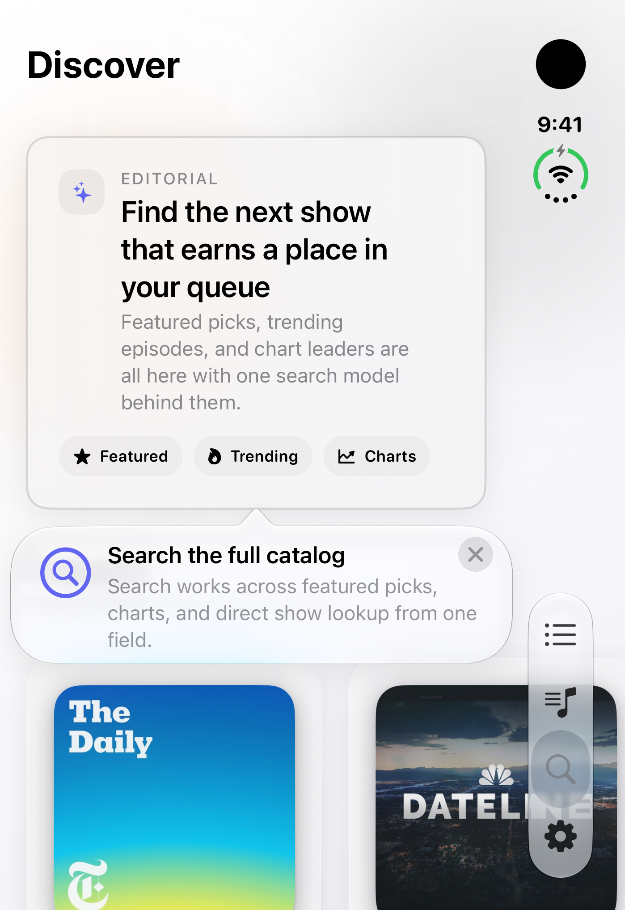
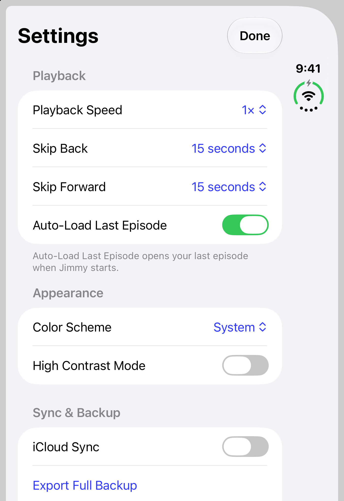
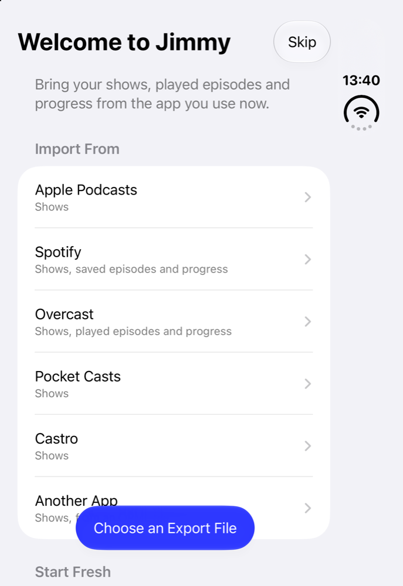
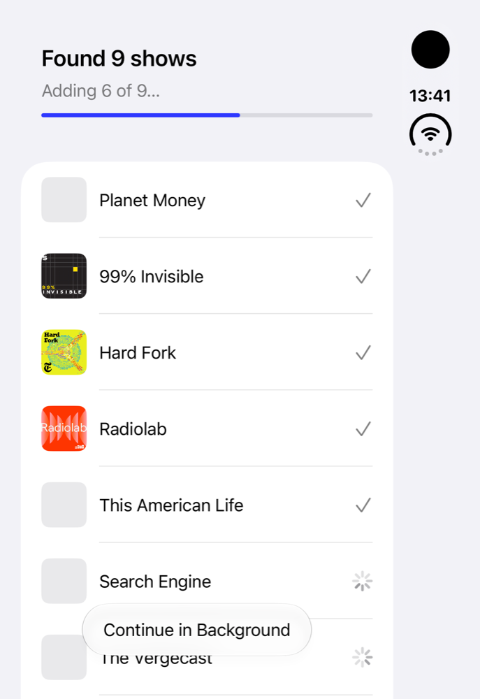
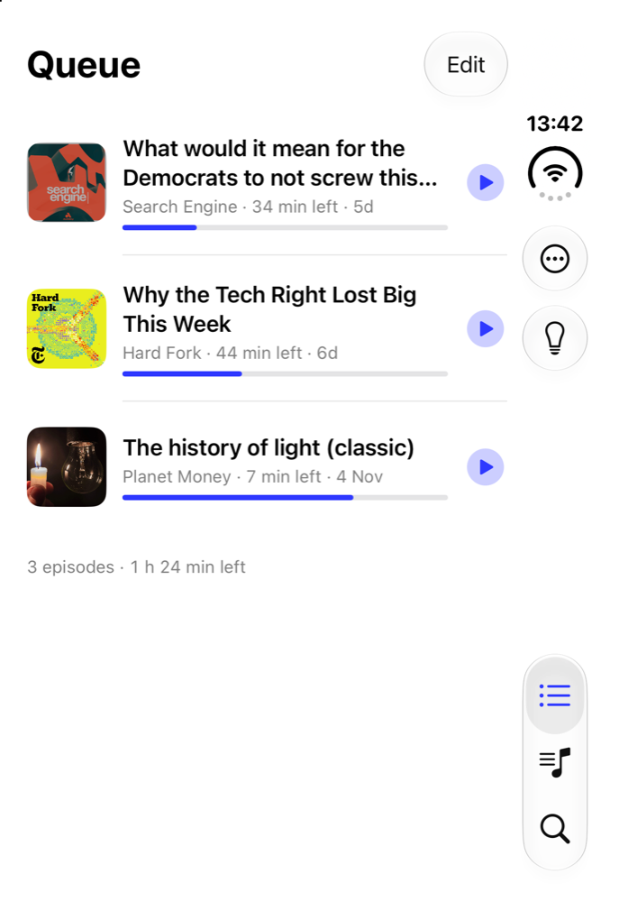

<div align="center">


# Jimmy

**A queue-centric podcast player for iPhone.**

One queue drives everything: save an episode from anywhere and it's the next thing that plays. Subscriptions,
progress, downloads and listening stats live on your device, and nothing is uploaded anywhere.


[](LICENSE)
[](https://github.com/chenkahana/Jimmy/actions/workflows/ci.yml)
[](CONTRIBUTING.md)

[](#getting-started) [](https://chenkahana.com/jimmy)

[Features](#features) · [Screenshots](#screenshots) · [Architecture](#architecture) · [Getting started](#getting-started) · [Roadmap](#roadmap) · [Contributing](#contributing)

<table>
  <tr>
    <td><picture><source media="(prefers-color-scheme: dark)" srcset="docs/screenshots/queue-dark.png"></picture></td>
    <td><picture><source media="(prefers-color-scheme: dark)" srcset="docs/screenshots/nowplaying-dark.png"></picture></td>
    <td><picture><source media="(prefers-color-scheme: dark)" srcset="docs/screenshots/podcast-dark.png"></picture></td>
  </tr>
</table>

</div>

---

## Features

| | |
|---|---|
| **One queue** | Save an episode from a show's page, Discover or Search and it joins the queue in play order. Drag to reorder, swipe for Play Next, Played, Download or Remove. |
| **Player** | Resume where you stopped, variable speed, skip silence, volume boost, a sleep timer (duration or end of episode), and chapters with their lengths. |
| **Library** | Your shows as an artwork grid with new-episode counts, plus per-show auto-queue and notification settings. |
| **Smart playlists, transcripts, bookmarks** | Rule-based playlists, transcripts where the feed provides them, timestamped bookmarks and listening stats. |
| **Downloads** | Episodes download in the background and play from disk, so the queue survives a bad connection. |
| **Bring your library** | First-run onboarding imports from Apple Podcasts (a four-tap Shortcut), Spotify, Overcast, Pocket Casts, Castro or any OPML file. |
| **On-device AI** | Up Next suggestions ranked from your own listening, and an assistant that acts on requests ("play the latest episode of…", "sleep in 20 minutes"). Apple's on-device model only; nothing goes to a server. |
| **Apple Watch and CarPlay** | The watch shows Now Playing, Queue and Recent and controls the phone; CarPlay browses the queue and library. |
| **iCloud sync (optional)** | Carries subscriptions, queue order and progress to your other devices through your own iCloud account. |
| **Private by design** | No accounts, analytics or crash-reporting SDKs. Feeds are fetched straight from each show's host. |

## Screenshots

<table>
  <tr>
    <td align="center"><picture><source media="(prefers-color-scheme: dark)" srcset="docs/screenshots/library-dark.png"></picture><br><sub>Library</sub></td>
    <td align="center"><picture><source media="(prefers-color-scheme: dark)" srcset="docs/screenshots/discover-dark.png"></picture><br><sub>Discover</sub></td>
    <td align="center"><picture><source media="(prefers-color-scheme: dark)" srcset="docs/screenshots/settings-dark.png"></picture><br><sub>Settings</sub></td>
  </tr>
  <tr>
    <td align="center"><picture><source media="(prefers-color-scheme: dark)" srcset="docs/screenshots/onboarding/1-welcome-dark.png"></picture><br><sub>Onboarding</sub></td>
    <td align="center"><picture><source media="(prefers-color-scheme: dark)" srcset="docs/screenshots/onboarding/3-progress-dark.png"></picture><br><sub>Importing your shows</sub></td>
    <td align="center"><picture><source media="(prefers-color-scheme: dark)" srcset="docs/screenshots/onboarding/5-queue-dark.png"></picture><br><sub>Your first queue</sub></td>
  </tr>
</table>

<sub>Screenshots follow your GitHub theme. They are captured from a demo library of public podcasts with
`make screenshots`.</sub>

## Architecture

Jimmy is a SwiftUI app over a tested core package, **JimmyKit**. The app holds one `@Observable` `AppModel`;
everything that touches the disk, the network or the audio session lives in JimmyKit and runs off the main actor.

```mermaid
flowchart LR
    subgraph Apps
        App[Jimmy for iPhone] --- CarPlay[CarPlay]
        Watch[Jimmy for Apple Watch]
    end
    App --> Model[AppModel<br/>@Observable]
    subgraph JimmyKit[JimmyKit · Swift package]
        Store[(Store<br/>GRDB · SQLite)]
        Feed[Feeds<br/>fetch · parse · refresh]
        Playback[Playback<br/>AVPlayer · Now Playing]
        Downloads[Downloads<br/>background URLSession]
        Import[Importers<br/>OPML · Apple · Spotify · Takeout]
    end
    Model --> JimmyKit
    Watch <-. WatchConnectivity .-> Model
    Feed --> Hosts[(Podcast hosts)]
```

| Path | What it holds |
|---|---|
| [`Jimmy/`](Jimmy) | The iPhone app: `AppModel`, screens, onboarding, CarPlay, on-device suggestions |
| [`Packages/JimmyKit`](Packages/JimmyKit) | Models, the GRDB store and migrations, feeds, playback, downloads, importers, watch session types |
| [`JimmyWatch/`](JimmyWatch) | The Apple Watch app |
| [`Tests/`](Tests) | App tests, plus 25 real-world feed fixtures (Libsyn, Megaphone, Transistor, Hebrew titles, malformed XML…) |

The full picture is in [docs/architecture.md](docs/architecture.md); the visual language in
[docs/design.md](docs/design.md).

## Getting started

### Requirements

- macOS with **Xcode 27** (iOS 27 SDK) and an iOS 27 simulator
- [XcodeGen](https://github.com/yonaskolb/XcodeGen) (`brew install xcodegen`)

### Build and run

```bash
git clone https://github.com/chenkahana/Jimmy.git
cd Jimmy
make bootstrap   # checks the toolchain, installs XcodeGen, generates Jimmy.xcodeproj
make run         # builds, installs and launches Jimmy in the simulator
```

The Xcode project is generated from [`project.yml`](project.yml) and isn't checked in. To run on your own device,
set your team in Xcode's **Signing & Capabilities** (or `DEVELOPMENT_TEAM` in `project.yml`, locally).

### Common tasks

| Command | What it does |
|---|---|
| `make build` | Builds the app for the simulator, unsigned (what CI runs) |
| `make test` | Runs the app's unit tests (`SIM="…"` picks the simulator) |
| `make kit` | Runs the JimmyKit package tests |
| `make watch` | Builds the watch app on its own |
| `make screenshots` | Seeds the demo library and recaptures `docs/screenshots/` in light and dark |
| `make help` | Lists every target |

## Roadmap

- Standalone playback and downloads on Apple Watch.
- A full device QA pass ([docs/qa.md](docs/qa.md)) and the first tagged release ([docs/release.md](docs/release.md)).

Ideas welcome: open a [feature request](https://github.com/chenkahana/Jimmy/issues/new?template=feature_request.yml).

## Privacy

Jimmy collects no data. Your library stays on your device, optional iCloud sync goes through your own iCloud
account, and there are no accounts, analytics or crash-reporting SDKs. Read the full
[privacy policy](docs/privacy.md).

## Contributing

Contributions are welcome, from a typo fix to a new feature.

- Read [CONTRIBUTING.md](CONTRIBUTING.md) for setup, conventions and the review checklist.
- Looking for a place to start? Try an issue labelled
  [`good first issue`](https://github.com/chenkahana/Jimmy/labels/good%20first%20issue) or
  [`help wanted`](https://github.com/chenkahana/Jimmy/labels/help%20wanted).
- Found a bug? Open a [bug report](https://github.com/chenkahana/Jimmy/issues/new?template=bug_report.yml).
- Security issues go through [SECURITY.md](SECURITY.md), never public issues.

Everyone taking part follows the [Code of Conduct](CODE_OF_CONDUCT.md). Changes are recorded in
[CHANGELOG.md](CHANGELOG.md).

## The family

Boaz, Jimmy and Edison are made by one independent developer, on the same principles: native Swift and SwiftUI,
private by design (no accounts, analytics or tracking), and open source under the Mozilla Public License 2.0.

<table>
  <tr>
    <td align="center" width="33%"><a href="https://github.com/chenkahana/Boaz"></a><br><b><a href="https://github.com/chenkahana/Boaz">Boaz</a></b><br><sub>A calm web browser for iPhone and Mac</sub></td>
    <td align="center" width="33%"><a href="https://github.com/chenkahana/Jimmy"></a><br><b><a href="https://github.com/chenkahana/Jimmy">Jimmy</a></b><br><sub>A queue-centric podcast player for iPhone</sub></td>
    <td align="center" width="33%"><a href="https://github.com/chenkahana/Edison"></a><br><b><a href="https://github.com/chenkahana/Edison">Edison</a></b><br><sub>Clipboard history and screenshots for Mac</sub></td>
  </tr>
</table>

<p align="center"><sub>More at <a href="https://chenkahana.com">chenkahana.com</a></sub></p>

## License

Copyright © 2025–2026 Chen Kahana. Jimmy is licensed under the [Mozilla Public License 2.0](LICENSE).
Third-party components and their licenses are listed in [THIRD_PARTY_NOTICES.md](THIRD_PARTY_NOTICES.md).
